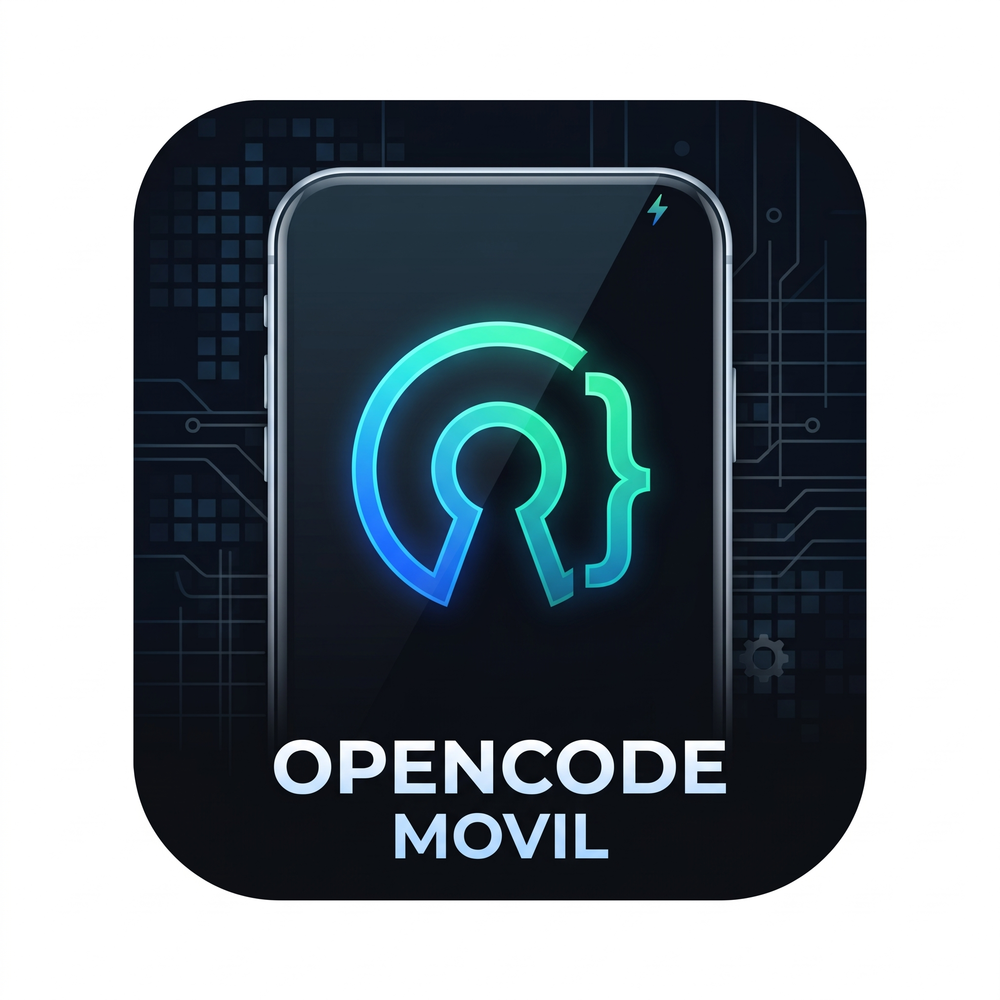

# OpenCodeMovil v1.0

<p align="center">
  
</p>

<p align="center">
  <strong>Tu entorno de IA y desarrollo móvil, impulsado por código abierto.</strong>
</p>

<p align="center">
  <a href="#licencia"></a>
  <a href="https://kotlinlang.org"></a>
  <a href="https://developer.android.com/jetpack/compose"></a>
  <a href="https://termux.dev"></a>
  <a href="#donaciones-y-apoyo"></a>
</p>

---

## 👨‍💻 Acerca del Proyecto

**OpenCodeMovil** es una plataforma nativa de ingeniería de software e inteligencia artificial para dispositivos móviles Android, desarrollada y mantenida por **ErasmoX (EX)**.

Inspirada en la elegancia visual de **Gemini** (tema oscuro estricto `#0C0D0E`, superficies `#16171A` y acentos neón azul-esmeralda) y la flexibilidad de gestión de modelos de **Open WebUI**, OpenCodeMovil permite ejecutar código, consultar modelos de vanguardia y administrar proyectos locales sin necesidad de un navegador web ni servidores remotos obligatorios.

---

## ⚡ Características Principales

- **Ejecución Local Sin Navegador (100% Nativo)**:
  - Diseñado exclusivamente para Android con **Jetpack Compose** y **Material 3**, logrando 60/120 FPS sin webviews lentos ni interfaces de navegador.
- **Skills Modulares & Arquitectura Extensible**:
  - Sistema modular preparado para integrar herramientas externas, comandos de terminal, analizadores de sintaxis y agentes autónomos.
- **Terminal Táctil y Consola en Tiempo Real**:
  - Consola inferior deslizable (*BottomSheet Drawer*) para visualizar logs en vivo del motor backend (`127.0.0.1:3001/api/logs`) con filtros coloreados (`[INFO]`, `[STREAM]`, `[ERROR]`, `[CONNECTED]`).
- **Streaming SSE Token por Token**:
  - Cliente de red reactivo construido sobre **OkHttp** y **Kotlin Coroutines / StateFlow** que renderiza el texto palabra por palabra en tiempo real.
- **Gestión Dinámica de Modelos (Estilo Open WebUI)**:
  - Selector superior interactivo para alternar al instante entre **DeepSeek V3**, **Claude 3.5 Sonnet**, **Gemini 2.0 Flash**, **Llama 3.3 70B**, **Qwen 2.5 Coder** y endpoints locales compatibles (Ollama / vLLM).
- **Gestión de Proyectos con Scoped Storage (`/MisProyectos`)**:
  - Integración nativa con el *Storage Access Framework* (`DocumentsContract`) para vincular carpetas en el almacenamiento compartido de Android y adjuntar archivos de código directamente en el contexto del chat.
- **Onboarding Asistido y Health Check Automatizado**:
  - Monitor continuo que realiza ping cada 2 segundos a `http://127.0.0.1:3001/api/health`, transitando automáticamente de la guía de bienvenida al chat principal en cuanto el motor está en línea.

---

## 🏛️ Arquitectura del Sistema

```
┌─────────────────────────────────────────────────────────────┐
│                   OpenCodeMovil (Android)                   │
│  - Jetpack Compose + Material 3                             │
│  - StateFlow + ViewModel + DataStore                        │
│  - UI: Header Isotipo + Chat + Terminal Drawer + Scoped SAF │
└──────────────┬──────────────────────────────┬───────────────┘
               │ (Health Check / Logs)        │ (SSE Streaming)
               │ HTTP Polling (2s)            │ HTTPS
               ▼                              ▼
┌──────────────────────────────┐ ┌────────────────────────────┐
│      Motor Local Termux      │ │  Proveedor Cloud / Modelo  │
│  - Termux (Debian / Linux)   │ │  - OpenRouter API          │
│  - Puerto 127.0.0.1:3001     │ │  - OpenAI Compatible API  │
│  - Node.js / Python Runtime  │ │  - DeepSeek, Claude, Llama │
│  - Ejecución de Scripts/Bash │ └────────────────────────────┘
└──────────────────────────────┘
```

---

## 📦 Métodos de Instalación

Puedes desplegar OpenCodeMovil mediante dos vías complementarias:

### Método 1: Instalación de la App Nativa (APK)

1. Descarga el paquete `.apk` oficial de **OpenCodeMovil**1. Descarga el paquete **.apk** oficial de **OpenCodeMovil**:

   [](https://github.com/ErasmoX/OpenCodeMovil/releases/latest/download/OpenCodeMovil.apk) desde la sección de *Releases* del repositorio o expórtalo desde el menú de compilación.
2. Abre el archivo en tu dispositivo Android y confirma la instalación (habilita la opción de instalar aplicaciones de orígenes desconocidos si el sistema lo solicita).
3. Al iniciar la aplicación, el **Asistente de Configuración** te guiará para vincular el backend local.

---

### Método 2: Instalación del Motor Local en Termux (Comando Maestro)

Para habilitar la ejecución local y la terminal en segundo plano:

1. **Instala Termux**:
   - Descarga la versión oficial y actualizada desde [F-Droid](https://f-droid.org/packages/com.termux/) o [GitHub Releases](https://github.com/termux/termux-app/releases). *(Evita la versión obsoleta de Google Play Store)*.

2. **Ejecuta el Comando Maestro**:
   Abre Termux y pega la siguiente instrucción de una sola línea:

   ```bash
   curl -fsSL https://raw.githubusercontent.com/TU_USUARIO/OpenCodeMovil/main/install.sh | bash
   ```

3. **Inicia el Servidor Backend**:
   El instalador configurará el entorno y levantará el servidor en `http://127.0.0.1:3001`.
   
4. **Vinculación Inmediata**:
   Abre la app **OpenCodeMovil**. El comprobador de salud detectará automáticamente el puerto `3001` y conmutará la interfaz a la pantalla de trabajo principal.

> **Nota:** Si solo deseas utilizar modelos en la nube (OpenRouter) sin ejecutar el motor local de Termux, puedes presionar **"Modo Directo (Cloud OpenRouter) →"** en cualquier momento para ingresar directamente.

---

## ⚙️ Configuración y Proveedores

En el menú de **Ajustes ⚙️** puedes configurar:

| Parámetro | Valor por defecto | Descripción |
| :--- | :--- | :--- |
| **API Key** | *(Vacío)* | Clave de acceso de [OpenRouter](https://openrouter.ai/) u OpenAI, almacenada con seguridad en DataStore local. |
| **Base URL** | `https://openrouter.ai/api/v1` | URL base compatible con OpenAI (`http://10.0.2.2:11434/v1` para Ollama en emulador o `http://127.0.0.1:11434/v1` en dispositivo). |
| **Motor Local**| `http://127.0.0.1:3001` | Dirección de enlace con el servidor de background en Termux. |
| **System Prompt** | *Programador experto* | Instrucciones de comportamiento para la generación de código. |

---

## 💖 Donaciones y Apoyo

OpenCodeMovil es un proyecto independiente de software libre creado con pasión para la comunidad de desarrolladores móviles. Si esta herramienta te resulta útil y deseas apoyar su desarrollo continuo, nuevas funcionalidades y optimizaciones, puedes realizar una donación a través de PayPal:

<p align="center">
  <a href="https://www.paypal.com/cgi-bin/webscr?cmd=_donations&business=erasno1@gmail.com&currency_code=USD&item_name=Donacion+OpenCodeMovil" target="_blank">
    
  </a>
</p>

- **Correo de PayPal:** `erasno1@gmail.com`
- **Desarrollador:** ErasmoX (EX)

¡Cualquier contribución es profundamente agradecida! 🚀

---

## 📄 Licencia

Este proyecto se distribuye bajo los términos de la **Licencia MIT**. Consulta el archivo `LICENSE` o el siguiente resumen para más detalles:

```text
MIT License

Copyright (c) 2026 ErasmoX (EX)

Permission is hereby granted, free of charge, to any person obtaining a copy
of this software and associated documentation files (the "Software"), to deal
in the Software without restriction, including without limitation the rights
to use, copy, modify, merge, publish, distribute, sublicense, and/or sell
copies of the Software, and to permit persons to whom the Software is
furnished to do so, subject to the following conditions:

The above copyright notice and this permission notice shall be included in all
copies or substantial portions of the Software.

THE SOFTWARE IS PROVIDED "AS IS", WITHOUT WARRANTY OF ANY KIND, EXPRESS OR
IMPLIED, INCLUDING BUT NOT LIMITED TO THE WARRANTIES OF MERCHANTABILITY,
FITNESS FOR A PARTICULAR PURPOSE AND NONINFRINGEMENT. IN NO EVENT SHALL THE
AUTHORS OR COPYRIGHT HOLDERS BE LIABLE FOR ANY CLAIM, DAMAGES OR OTHER
LIABILITY, WHETHER IN AN ACTION OF CONTRACT, TORT OR OTHERWISE, ARISING FROM,
OUT OF OR IN CONNECTION WITH THE SOFTWARE OR THE USE OR OTHER DEALINGS IN THE
SOFTWARE.
```
